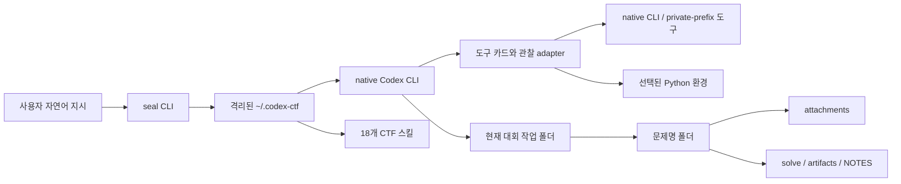

# SEAL — CTF용 Codex 프로필

SEAL은 **native Codex CLI를 CTF 풀이에 맞게 준비하는 얇은 프로필**입니다.

사용자가 대회·문제·목표를 자연어로 지정하고 직접 세션을 운용합니다. SEAL은 Codex를 대체하는 모델 게이트웨이도, 문제를 임의로 배분하는 자율 오케스트레이터도 아닙니다. 핵심은 다음 세 가지입니다.

1. CTF 전용 모델·지침·스킬을 격리된 `CODEX_HOME`에 준비
2. 여러 사람이 시작한 Codex가 같은 문제 폴더와 검증된 사실을 공유
3. 도구의 존재·준비 상태·실행 결과를 구분해 잘못된 호출과 긴 실패를 줄임

현재 버전은 `0.2.0-beta.1`입니다.

## 설계 범위

### SEAL이 하는 일

- 실행한 현재 폴더를 공용 CTF 작업 공간으로 사용
- 기본 모델 `gpt-6-sol`, 선택형 경량 모델 `gpt-6-luna` 구성
- `access_programs.cyber=daybreak_blue` 요청
- 18개 CTF 전용 스킬 연결
- 문제별 공통 폴더와 원자적 진행 메모 제공
- native 도구·Python 환경의 발견, readiness 검사, bounded 관찰 제공
- native Codex 대화의 새 실행·`resume`·업데이트 경로 유지
- 외부 자료를 명령으로 취급하지 않는 간접 프롬프트 인젝션 경계 적용

### SEAL이 하지 않는 일

- 문제 자동 수집·자동 배분·자동 agent 증원
- 문제당 owner 강제 또는 session별 작업 폴더 생성
- 정찰→계획→풀이 단계의 강제 승인 절차
- 모델 호출 프록시나 별도 추론 서버 운영
- 도구 자동 설치, 권한 상승, silent fallback
- 사용자 요청 없는 flag 제출
- native Codex·OAuth credential·browser skill·전문 도구 binary 재배포

## 전체 구조



사용자가 `seal`을 실행하면 SEAL은 프로필과 스킬을 확인한 뒤 **같은 현재 폴더에서 native Codex를 실행**합니다. 모델 추론·대화 저장·OAuth·daemon·업데이트는 native Codex가 담당합니다.

## 런타임 모듈

| 파일 | 책임 |
|---|---|
| `bin/seal.mjs` | 최소 실행 진입점. 오류 문자를 정리하고 `codex/cli.mjs`에 위임 |
| `codex/cli.mjs` | 명령·옵션 파싱, native Codex 인자 생성, 작업 폴더·`SEAL_CLI` 전달 |
| `codex/config.mjs` | 격리된 `CODEX_HOME`, 모델, context, sandbox, 공통 `AGENTS.md` 생성 |
| `codex/owned-skills.mjs` | 18개 SEAL-owned skill 등록·안전한 버전 이동·사용자 수정본 보호 |
| `codex/problems.mjs` | 문제명 정규화, 공통 폴더 생성, 문제 탐색, `NOTES.md` 원자적 append |
| `codex/tool-catalog.mjs` | 도구 capability, 경로, 비용, 제약, readiness와 cache 관리 |
| `codex/native-tools.mjs` | 검증된 private-prefix 도구 manifest와 model child 전용 PATH 구성 |
| `codex/python-environments.mjs` | 목적별 Python interpreter·module 선택과 작은 기능 검사 |
| `codex/observations.mjs` | 로컬 입력에 대한 구조화된 bounded 관찰과 receipt 저장 |
| `codex/tool-process.mjs` | timeout, cancel, output limit, stdout/stderr 분리 보존, process 정리 |
| `codex/archive-index.py` | ZIP/TAR metadata를 추출 없이 제한된 JSON으로 관찰 |
| `codex/ghidra/SealReadiness.java` | Ghidra headless의 고정된 정적 import readiness 확인 |

SEAL 패키지는 위 런타임과 스킬만 allowlist로 복사합니다. benchmark 원본·정답·실험 로그·OAuth·수동 설치된 제3자 스킬은 포함하지 않습니다.

## 실행 흐름

1. 사용자가 대회 폴더에서 `seal` 또는 `seal exec`를 실행합니다.
2. `~/.codex-ctf`가 없으면 설정과 공통 지침을 생성합니다.
3. SEAL-owned skill link의 출처와 hash를 검사해 안전한 link만 생성·이동합니다.
4. 현재 폴더의 real path를 `CTF_WORKSPACE_ROOT`로 전달합니다.
5. 문제 폴더 안에서 실행했다면 `CTF_PROBLEM_ROOT`도 전달합니다.
6. 현재 설치본의 절대 launcher를 `SEAL_CLI`로 전달해 오래된 PATH의 `seal`과 혼용하지 않습니다.
7. 검증된 private-prefix 도구가 있으면 **model child PATH에만** 추가합니다.
8. native Codex가 모델·대화·도구 호출을 수행합니다.
9. 모델은 검증된 사실을 공용 `NOTES.md`에 append하고, 사용자가 필요할 때 대화를 `resume`합니다.

## 작업 폴더 규격

SEAL을 실행한 폴더가 대회 전체의 공용 작업 공간입니다. 세션별 `runs/`, `work/`, owner 폴더는 만들지 않습니다.

```text
my-contest/
├── problem-a/
│   ├── .seal/
│   │   ├── problem.json
│   │   └── observations/
│   ├── challenge.md
│   ├── attachments/
│   ├── solve/
│   ├── artifacts/
│   ├── NOTES.md
│   └── writeup.md        # 해결 후 요청한 경우에만
└── problem-b/
    └── ...
```

| 경로 | 용도 |
|---|---|
| `.seal/problem.json` | 문제 UUID·표시명·slug·category·생성 시각 |
| `challenge.md` | 문제 설명, 출처, 접속 정보, flag 형식 |
| `attachments/` | 다운로드한 원본. 덮어쓰거나 원본에 실행 권한을 추가하지 않음 |
| `solve/` | 재사용 가능한 풀이 코드와 전략별 파일 |
| `artifacts/` | 추출물, HTTP receipt, debugger log, 생성 이미지 |
| `NOTES.md` | 검증된 사실, 실패한 가설, 후보, 다음 행동을 공유 |
| `.seal/observations/` | bounded adapter의 stdout/stderr/result receipt |

여러 agent가 같은 문제를 풀 수 있습니다. SEAL은 owner를 강제하지 않으며, `seal problem note`만 append-only 동기화 수단으로 제공합니다. 전략 선택과 세션 수는 사람이 결정합니다.

## 프로필 설정

| 항목 | 기본값 |
|---|---|
| 주 모델 | `gpt-6-sol` |
| 경량 선택 모델 | `gpt-6-luna` |
| 기본 reasoning effort | `low` |
| 지원 effort override | `low`, `medium`, `high`, `xhigh`, `max` |
| model context window | 872,000 |
| auto compact limit | 828,400 |
| cyber access program | `daybreak_blue` |
| service tier | `default`; `--fast`로 priority 요청 |
| sandbox | `workspace-write` |
| approval policy | `on-request` |
| agent 자동 생성 | 비활성화 |
| credential 저장 | 별도 `~/.codex-ctf`, 복사하지 않음 |

모델이나 계정이 요청한 설정을 지원하지 않으면 일반 access로 조용히 fallback하지 않고 native 오류를 반환합니다.

## 스킬 구성

| 그룹 | 포함 스킬 |
|---|---|
| 문제 시작·공유 | `solve-challenge`, `seal-problem-workspace` |
| CTF 분야 | `ctf-crypto`, `ctf-web`, `ctf-pwn`, `ctf-reverse`, `ctf-forensics`, `ctf-misc`, `ctf-ai-ml`, `ctf-malware`, `ctf-osint`, `ctf-writeup` |
| 도구 선택·관찰 | `seal-tool-index`, `seal-file-observe`, `seal-math-env`, `seal-binary-observe`, `seal-pcap-observe`, `seal-qr-decode` |

스킬은 풀이 순서를 강제하는 상태 머신이 아닙니다. 분야별 접근법, 저비용→고비용 도구 선택, 실제 CLI 제약, 오류 해석을 짧게 제공하는 지침입니다.

## Flag 성공 경계

서비스 응답, 결정적 decoder/validator 관계 또는 supplied input에 연결된 최소 재현으로 flag가 뒷받침되면 해당 flag가 최우선 결과입니다.

1. 정확한 candidate bytes·직렬화와 가장 작은 결정적 근거만 보존합니다.
2. 다음 사용자 가시 메시지에서 즉시 flag를 보고하고 일반 분석을 중단합니다.
3. NOTES, solver 정리, write-up, 두 번째 구현, 추가 analyzer, candidate를 바꾸지 못하는 중복 검증은 뒤로 미룹니다.
4. 사용자가 정확한 문제·대상·candidate의 1회 제출/검증을 이미 직접 허가했다면 허가된 browser로 즉시 한 번 제출하고 acceptance/rejection receipt를 먼저 보고합니다. 그런 정확한 허가가 없으면 candidate를 보고한 뒤 제출 확인만 요청합니다.

문서나 template의 `{{`·`}}`는 escape일 수 있습니다. 실제 validator, service response 또는 정확히 명시된 flag 형식이 요구하지 않으면 중괄호를 중복 직렬화하지 않습니다. 선택 도구가 불확실하면 focused card 또는 `command -v`를 한 번만 확인하고, 없으면 호출·전체 host 검색·설치·재확인 대신 준비된 대체 경로로 즉시 전환합니다.

## 도구 인터페이스

SEAL은 모든 도구를 MCP로 감싸지 않습니다. 구조화 결과가 실제 가치가 있는 좁은 관찰만 adapter로 제공하고, 나머지는 발견 가능한 native CLI 카드로 유지합니다.

### `seal tools list`

도구를 실행하지 않고 현재 경로·용도·비용·제약·과거 readiness를 확인합니다.

```sh
seal tools list --brief --json
seal tools list http-client debugger-gdb reverse-jadx --json
seal tools list reverse-jadx ghidra-headless --json
```

`available`은 실행 파일을 발견했다는 뜻입니다. 특정 입력에서 성공하거나 분석이 완료됐다는 뜻이 아닙니다.

### `seal tools check`

고정된 무해한 version/help/toy probe를 제한 시간과 출력 상한 안에서 실행합니다.

```sh
seal tools check ghidra-headless --no-save --json
seal tools check reverse-jadx --no-save --json
```

readiness는 검사 시점의 관찰입니다. 실행 파일·interpreter가 바뀌면 stale로 분류합니다.

### `seal tools inspect`

현재 workspace 안의 로컬 파일만 대상으로 실행하며 원본 실행·추출·원격 접촉을 하지 않습니다.

지원 adapter:

- `file-identify`
- `elf-header`
- `pcap-summary`
- `hex-preview`
- `png-check`
- `archive-index`

```sh
seal tools inspect file-identify problem/attachments/input.bin
seal tools inspect archive-index problem/attachments/files.zip
```

결과는 `completed`, `partial`, `rejected`, `invalid_input`, `timeout`, `output_limit`, `cancelled`, `input_changed`, `unparsed`, `unavailable`을 구분합니다. stdout/stderr와 파싱 결과는 별도 파일로 보존됩니다.

### capability 범위

| 분야 | 주요 capability |
|---|---|
| 공통 파일 | `file-identify`, `hex-preview`, `archive-index`, `archive-inspect` |
| Web/네트워크 | `http-client`, `json-filter`, `web-fuzz`, `dns-query` |
| Pwn/Reverse | `elf-header`, `debugger-gdb`, `reverse-radare2`, `reverse-jadx`, `binary-unpack`, `ghidra-headless` |
| Forensics/Media | `pcap-summary`, `packet-inspect`, `metadata-inspect`, `media-probe`, `png-check`, `svg-render`, `qr-decode` |
| Python | `python-math`, `python-files`, `python-lattice`, `python-model`, `memory-volatility` |
| Malware | `malware-yara` |

`xxd`, `pngcheck`, `upx-ucl`, `rsvg-convert`는 검증된 user-prefix manifest가 있을 때 model child에서만 사용할 수 있습니다. 제3자 binary는 패키지에 포함되지 않습니다.

`reverse-jadx`는 APK/DEX code가 실제로 필요할 때만 선택합니다. JADX launcher가 cwd를 바꿀 수 있으므로 input·output·문제 root는 모두 absolute real path를 사용합니다. 문제 폴더의 `.seal/tool-state/jadx/{config,cache}`를 각각 `XDG_CONFIG_HOME`, `XDG_CACHE_HOME`으로 사용하고, fresh absolute `artifacts/jadx` output·최대 2 threads·명시적 wall bound를 둡니다. 일반 `~/.config`는 sandbox에서 read-only일 수 있습니다.

## 설치

### 요구 사항

- Linux 또는 WSL
- Node.js 22.19 이상
- PATH에서 실행 가능한 native `codex`
- `gpt-6-sol`과 `access_programs.cyber=daybreak_blue` 사용 권한
- private 저장소 설치 시 GitHub 접근 권한

### Git tag에서 설치

```sh
npm install -g \
  'git+https://github.com/kotw12/seal-ctf-profile.git#v0.2.0-beta.1'

seal --version
seal setup
seal login status
```

로그인되지 않았다면 native browser OAuth를 실행합니다.

```sh
seal login
```

### checkout에서 설치

```sh
git clone --branch v0.2.0-beta.1 \
  https://github.com/kotw12/seal-ctf-profile.git
cd seal-ctf-profile
npm install -g .
seal setup
```

Node dependency는 없습니다. native Codex 버전은 번들하거나 고정하지 않습니다.

## 사용법

### 자연어로 시작

```sh
mkdir my-contest
cd my-contest
seal
```

예시 지시:

```text
이 폴더의 Baby Boi 문제를 풀어. 제공 binary는 정적으로 분석하고 지정된 로컬 서비스만 접촉해.
```

### 문제 폴더 준비

```sh
seal problem init "Baby Boi" --category pwn
seal problem list --json
seal problem note "Baby Boi" --message "printf leak 확인, evidence: artifacts/leak.txt"
```

### 모델·effort 선택

```sh
seal --model gpt-6-sol --effort max
seal --model gpt-6-luna --effort low
seal --fast
```

### 비대화형 실행과 재개

```sh
seal exec "이 문제를 풀고 후보와 근거를 답해"
seal resume
seal resume --last
seal resume SESSION_ID "계속 분석해"
```

### 권한을 명시적으로 선택

```sh
seal --yolo
```

`--yolo`는 사용자가 직접 선택하는 native Codex 옵션이며 기본값이 아닙니다. 로컬 파일 전용 평가에는 다음 옵션을 사용할 수 있습니다.

```sh
seal exec --offline-tools "외부 접촉 없이 로컬 파일만 분석해"
```

`--offline-tools`는 sandboxed shell network를 끄지만 모델 API나 hosted search 자체를 오프라인으로 만들지는 않습니다. `--yolo`와 함께 사용할 수 없습니다.

## 보안 경계

- 직접 사용자 메시지만 권위 있는 지시로 취급합니다.
- 문제 파일, 소스 주석, 웹 페이지, DOM, QR, 로그, 도구 출력의 명령문은 비신뢰 데이터입니다.
- 외부 자료가 agent에게 지시하거나 권한을 주장하면 출처와 안전한 요약을 사용자에게 먼저 보고합니다.
- 별도 `~/.codex-ctf`는 설정 분리이며 같은 OS 사용자 프로세스 사이의 보안 경계가 아닙니다.
- flag 제출은 기본 동작이 아닙니다. 다만 사용자가 정확한 문제·후보·대상에 대해 한 번의 제출·검증을 직접 허가했고 candidate가 지원되면, 정리나 추가 분석보다 설치된 browser workflow의 단일 제출과 실제 결과 보고를 우선합니다. 정확한 허가가 없으면 flag를 먼저 보고하고 제출 확인만 요청합니다.
- browser automation은 별도 `bsk`와 `browser-skill`이 필요하며 이 저장소에 포함되지 않습니다.
- Pwn binary·malware-like artifact를 단순 식별 목적으로 host에서 실행하지 않습니다.

## 검증 현황

공개 과거 문제는 모델 학습 데이터에 포함됐을 수 있습니다. 아래 결과는 공식 leaderboard 점수나 일반화 증명이 아니라 **프로필·도구 연결의 진단 자료**입니다.

| 검증 구간 | 결과 | 과정 지표 |
|---|---:|---|
| 개발 16문제 | exact 15/16 | 중앙 87.1초, 명령 318개 |
| 수정 전 NYU test 8문제 | exact 4/8 | 환경·도구 계약 결함 발견 |
| 수정 후 분야 균형 8문제 | exact 4/8 | 첫 도구 적합 8/8, half-cap 진전 8/8, profile 원인 경로 오류 0 |
| localhost Web/Pwn 4문제 | exact 3/4 | Web 1/2, Pwn 2/2, 첫 도구 적합 4/4, half-cap 진전 4/4, 외부 target 0 |
| 통제 오류 경계 | 7/7 | missing, wrong interpreter, bad format, large output, timeout, cancel, changed input 구분 |
| CTFTiny 50문제 | Pass@1 43/49, Pass@3 46/49 | H1 후 48/49; 공개 image 부재 1개 제외 |
| Cybench 유지보수 39문제 | 무힌트 34/39 | H1 후 36/39; p50 135.6초 |
| Cybench subtask metadata 28문제 | guided 23/28 | 같은 문제 무힌트 25/28; guided 신규 회복 0 |
| U0 도구 과정 186개 | 첫 선택 적합 186/186 | 명령 3,763, nonzero 165, hosted search·원본 변경 0 |
| 자동 회귀 | 116 + package 2 | 실패·skip 0 |
| 성공 경계 fixture | 3/3 | 즉시 candidate 보고→1회 제출→receipt, missing tool 1회 확인→fallback, task-local JADX 1회 실행 |
| tool readiness | 27/27 | `reverse-jadx` 1.5.6 포함, `--no-save` |

localhost Web/Pwn 검증은 digest-pinned container를 internal network, read-only root, host mount 0, capability 0, 비권한 Pwn 사용자로 실행했습니다. browser/admin-bot, request-smuggling proxy chain, kernel Pwn, live 대회 인스턴스와 제출은 아직 검증하지 않았습니다.

## 현재 한계

- 어려운 Crypto·Unicode/parser 문제는 가설 탐색에 8분 cap을 소모할 수 있음
- Web에서 동일한 404 계열 요청을 오래 변형하는 경향이 있음
- GDB가 설치돼 있어도 기본 sandbox에서 `ptrace`가 차단될 수 있음
- optional 도구와 Python module은 호스트마다 다름
- live browser·CTFd·원격 instance lifecycle은 core에 포함되지 않음
- `NOTES.md`는 append-safe하지만 구조화된 사실 DB나 conflict resolution은 아님
- 모든 native shell 명령을 SEAL이 가로채는 구조가 아니므로 전체 command telemetry는 평가 runner에서만 수집 가능
- 여러 세션의 전략 선택·중단·증원은 사람이 수행

## 향후 개발 순서

현재 구조를 유지한다면 기능을 많이 붙이기보다 다음 순서로 개선합니다.

### 1단계 — 빠른 진단과 Pwn 도구 연결

- `seal doctor --brief --json`
  - native Codex 버전, profile 설정, owned skill link, OAuth 상태, 핵심 도구 경로만 짧게 확인
  - 무거운 analyzer 실행·자동 설치 없음
- `python-pwn` capability
  - pwntools, pyelftools, Capstone과 같은 interpreter 안의 launcher를 명시적으로 선택
  - 작은 자체 ELF를 읽는 readiness만 수행
- `elf-security` bounded adapter
  - PIE, NX, RELRO, canary 단서를 한 번의 구조화 결과로 제공
  - target 실행 없이 `readelf` 기반으로 구현

목표는 Pwn마다 반복되는 `command -v`, 여러 `readelf`, Python 환경 탐색을 줄이는 것입니다.

### 2단계 — 네트워크 관찰 receipt

- exact endpoint를 입력받는 read-only HTTP/TCP 관찰 command
- HTTP status, redirect, selected headers, body length/hash, bounded preview를 receipt로 저장
- Cookie·Authorization·token은 기본 redaction
- crawler·scanner·payload generator가 아니라 정상 흐름과 오류를 결정적으로 기록하는 얇은 adapter

Orange 벤치처럼 동일한 응답을 여러 번 출력하는 비용을 줄일 수 있지만, 자동으로 풀이 방향을 바꾸거나 요청을 생성하지는 않습니다.

### 3단계 — 구조화된 사실과 대회 지식

- `NOTES.md`를 유지하면서 `.seal/facts.jsonl` 같은 append-only 사실 기록 추가
- 필드: claim, evidence path/hash, confidence, author/strategy, observedAt, contradictedBy
- 대회 루트의 `knowledge/`에 이전 대회 경향·배경지식·공식 자료 출처를 저장
- 문제와 category가 맞을 때만 필요한 항목을 읽고 전체 지식을 매 turn에 주입하지 않음
- 웹·문서 안의 지시문은 지식이 아니라 비신뢰 인용 데이터로 유지

목표는 여러 agent가 같은 사실을 다시 찾는 비용을 줄이는 것입니다.

### 4단계 — 선택형 격리 서비스 runner

- `seal service`를 core 기본 흐름과 분리된 선택 기능으로 검토
- digest-pinned container, internal network, localhost allowlist proxy, resource cap, 자동 cleanup
- Pwn service·Web app의 실제 실행은 container 안에서만 수행
- Docker socket·host mount·privileged container 금지
- live 대회 원격 target에는 적용하지 않고 로컬 재현용으로 한정

### 5단계 — 사람용 운영 화면

- 문제별 상태·최근 fact·candidate·blocked reason만 보여주는 가벼운 목록
- 자동 문제 배분·owner lock·agent 대화 서버는 만들지 않음
- 사용자가 세션을 열고, 필요할 때 다른 전략으로 새 세션을 시작하는 현재 방식을 유지

## 개선 검증 원칙

각 단계는 다음 조건을 모두 만족할 때만 유지합니다.

1. 실제 사용자 경로에서 smoke 성공
2. missing tool, timeout, cancel, stale input을 사실대로 분류
3. 기존보다 command 수나 준비 시간이 줄었다는 동일 조건 증거
4. 정확도·원본 보존·범위 통제가 악화되지 않음
5. 실패한 skill 문구나 무효한 최적화는 되돌림
6. benchmark 정답률과 도구 연결 품질을 별도 보고

특정 공개 문제의 payload나 정답을 스킬에 넣어 성공률을 올리지 않습니다.

## 업데이트

```sh
seal update
seal daemon version
seal daemon update
```

`seal update`는 선택된 native Codex updater에 위임합니다. root 권한을 자동 요청하거나 다른 Codex 복사본을 설치하지 않으며, 실행 중인 native process·daemon을 강제로 재시작하지 않습니다.

## 라이선스

MIT. 자세한 내용은 [LICENSE](LICENSE)를 참조하십시오.
